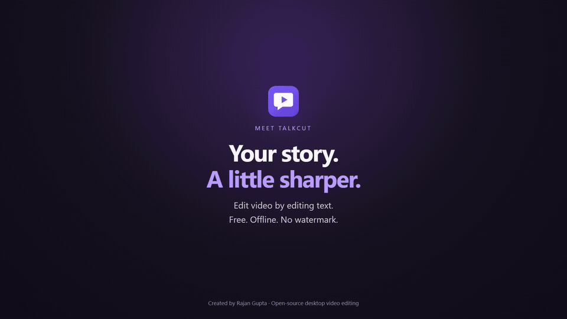
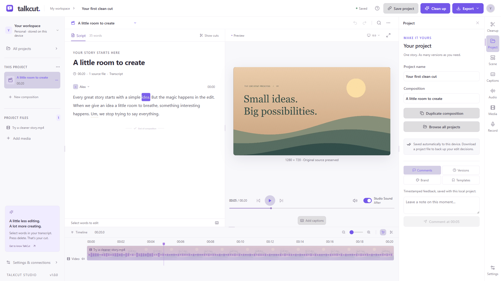
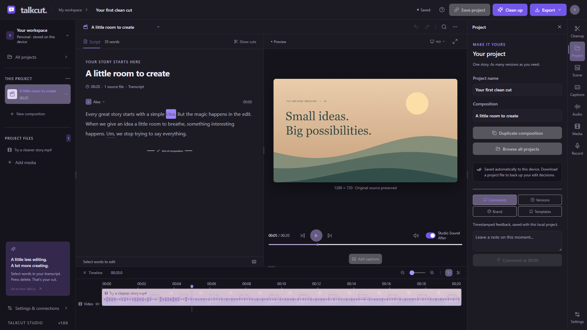

<p align="center"></p>
<h1 align="center">TalkCut</h1>
<p align="center">Owned and maintained by <strong>Rajan Gupta</strong></p>

**Free, offline Descript alternative. Edit video by editing text, remove ums in one click, Studio Sound, 4K export, no watermark.**

[](LICENSE)
[](https://github.com/iamspyder/talkcut/releases/latest)
[](https://github.com/iamspyder/talkcut/releases)
[](https://github.com/iamspyder/talkcut/actions/workflows/ci.yml)



*Replace this placeholder GIF with an Import → Clean up → Studio Sound → Export recording before announcement. Screenshots below show the real app. Links/badges become active after the repository and release exist.*

## Download

| Platform | Latest release |
| --- | --- |
| Windows x64 (NSIS) | [Download .exe](https://github.com/iamspyder/talkcut/releases/latest/download/TalkCut-Windows-x64.exe) |
| macOS Intel / Apple Silicon with Rosetta | [Download .dmg](https://github.com/iamspyder/talkcut/releases/latest/download/TalkCut-macOS-x64.dmg) |
| Linux x86_64 | [Download AppImage](https://github.com/iamspyder/talkcut/releases/latest/download/TalkCut-Linux-x86_64.AppImage) |

[All releases, SHA-256 checksums and update metadata](https://github.com/iamspyder/talkcut/releases). Local preparation has not uploaded public binaries. macOS/Linux packages must be smoke-tested on their target platforms. For AppImage, make the downloaded file executable before launching.

This app bundles FFmpeg/ffprobe, including GPL-enabled builds. [Third-party notices and source/build notes](THIRD_PARTY_NOTICES.md) describe their separate terms. TalkCut's own code is MIT licensed.

## Features

- **Edit the words, edit the video:** cut, correct and rearrange a word-timestamped transcript. Preserve originals with non-destructive edits and Undo/Redo.
- **Offline transcription:** whisper.cpp with base/small/medium models. Download once, transcribe locally thereafter.
- **One-click cleanup:** preview filler words, long gaps and adjacent repeated takes; apply as one undoable edit and review removed text/times.
- **Studio Sound:** DeepFilterNet voice cleanup plus FFmpeg loudness normalization, with Before/After preview after local preparation.
- **No watermark:** MP4 through 4K, MP3, SRT, WebVTT and text export. Quality depends on the source and hardware.
- Captions, media/text/audio layers, recording, local projects, a bundled sample, a dismissible tour and light/dark themes.
- Draggable dividers resize the sidebar, Script/Preview, tools and timeline. Sizes persist; double-click resets; arrow keys adjust.
- **Optional AI:** OpenAI, fal, ElevenLabs and Pexels are off by default under Settings → Optional AI. Core editing needs no account or keys.

Recognition and cleanup need review. Retake detection conservatively targets adjacent repeated phrases, not every possible mistake.

## Screenshots




## How it works

1. Import or drop a recording, or select **Try with a sample**.
2. Download a model in Settings and transcribe. Select words and press Delete to cut their media intervals.
3. Use **Clean up** to preview fillers, silence and retakes, then Apply or Undo.
4. Prepare **Studio Sound** locally and compare Before/After at the same playhead.
5. Add captions and export. FFmpeg renders a new file; source media remains intact.

Space plays/pauses, Del cuts, Ctrl+Z undoes, and Ctrl+E opens Export. See tooltips for shortcuts.

## Privacy

**Core transcription, editing, cleanup and export run locally.** No account, API key or built-in telemetry is required. Files stay in your local application-data directory.

Model downloads and manual update checks contact their download services. Explicitly enabling and using Optional AI sends selected media/text to the chosen provider under its policies. Keys entered in Settings stay in memory for the session. Recording uses OS media permissions.

## System requirements

- Windows 10/11 x64, macOS 12+ on Intel (Apple Silicon requires Rosetta 2 for the current x64 package), or a modern Electron-compatible x86_64 Linux desktop.
- 8 GB RAM recommended for base/small; 16 GB+ for medium and 4K. These are recommendations, not measured minimum guarantees.
- Disk space for the app, originals, processing caches and exports. Models use about 148 MB / 488 MB / 1.53 GB.
- A CPU compatible with the native helpers. The default CPU workflow needs no GPU; speed varies by hardware.
- Internet for installation/model downloads, not for core editing afterwards. The bundled sample works immediately.

## Build from source

Use Node.js 24, npm and Git. macOS/Linux native builds need CMake, a C++ toolchain and platform SDKs. Windows uses prebuilt x64 helpers. Build on the target OS.

```sh
git clone https://github.com/iamspyder/talkcut.git
cd talkcut/app
npm ci
npm run native:setup
npm run lint
npm test
npm run build
npm run desktop
```

Installers: `npm run dist:win`, `npm run dist:mac`, `npm run dist:linux`. Local commands never publish. The release workflow builds x64 macOS packages, using Rosetta on ARM hosts. See [release instructions](docs/RELEASING.md), [development details](app/README.md) and [verification scope](docs/LAUNCH_VERIFICATION.md).

## Roadmap

- Target-platform smoke tests, Windows signing and macOS signing/notarization.
- Native Apple Silicon packaging and broader Linux/CPU validation.
- Improved multilingual transcript correction and retake previews.
- Accessible timeline editing, long-recording performance and project portability.

These are plans, not delivery-date commitments.

## Contributing

Read [CONTRIBUTING.md](CONTRIBUTING.md) and [CODE_OF_CONDUCT.md](CODE_OF_CONDUCT.md). Use the bug/feature templates; report vulnerabilities through [SECURITY.md](SECURITY.md). **Rajan Gupta is the sole project owner and maintainer.** Contributors retain copyright in their contributions.

## Credits and license

TalkCut code and original branding: **Copyright © 2026 Rajan Gupta**, [MIT](LICENSE). Projects studied: [autoEdit_2](https://github.com/OpenNewsLabs/autoEdit_2), [auto-editor](https://github.com/WyattBlue/auto-editor), [DeepFilterNet](https://github.com/Rikorose/DeepFilterNet) and [whisper.cpp](https://github.com/ggml-org/whisper.cpp).

Dependencies retain their own authorship and licenses. See [THIRD_PARTY_NOTICES.md](THIRD_PARTY_NOTICES.md), [the full dependency inventory](docs/DEPENDENCIES.md) and `app/LICENSES/`. Descript is a third-party product name; TalkCut is independent and unaffiliated.

## FAQ

**Is it really free?** Yes: local editing and exports have no watermark. Optional cloud providers may charge.

**Can I work offline?** Yes, after downloading the app and one transcription model. The bundled sample works before a model download. Updates and Optional AI require internet.

**Why does Windows SmartScreen warn me?** Initial builds are unsigned unless a certificate is configured. Verify the GitHub release and SHA-256 checksum. If you trust the download, choose More info → Run anyway. Do not disable SmartScreen globally. Checksums verify integrity, not publisher identity or safety.

**What about macOS Gatekeeper and updates?** Unsigned/unnotarized releases may be blocked. Prefer signed/notarized builds or build from source. Automatic macOS updates require signing; the updater cannot bypass OS checks.

**Is every commercial-editor feature included?** No. v1 focuses on offline transcription, text editing, cleanup, Studio Sound and export.

**Is Studio Sound instant?** The sample includes processed audio. Your own recordings need one local enhancement pass, then A/B uses cached media.

**Will 4K export improve a low-resolution recording?** It can render a 3840×2160 landscape canvas but cannot recover missing source detail.

**Where are my files?** In Electron's per-user TalkCut application-data directory, under `media-library`. JSON project backups contain edits, so keep original media too.
